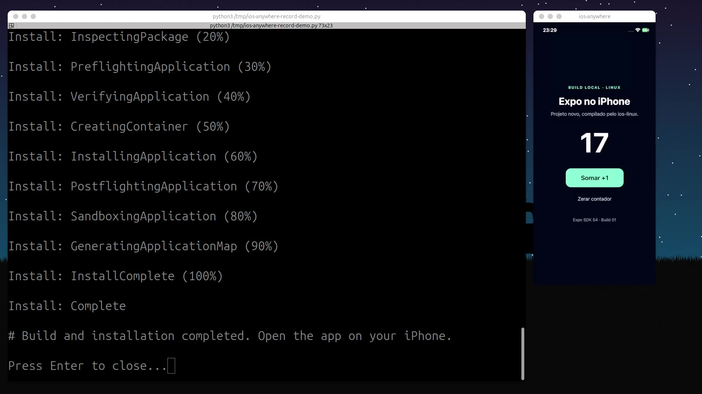

<div align="center">

# ios-anywhere

### From your project to your iPhone. Built locally on Linux.

**Expo · Godot · Compile · Sign · Install**


[](https://github.com/rodriguesabner/ios-anywhere/actions/workflows/tests.yml?query=branch%3Amain)
[Website](https://rodriguesabner.github.io/ios-anywhere/) · [Get started](#installation) · [Demo](#demo) · [Documentation](#documentation)

</div>

Build, sign, and install iOS apps locally on Linux. Supports **Godot** and **Expo**, with valid Apple signing credentials. No Mac or EAS Build is needed to run the local build workflow.

**Experimental:** start with Godot 4.5.1 / GDScript for the guided setup. Expo has an experimental setup for Ubuntu 24.04. Linux x86_64 is the tested host platform; not every project is supported.

<a id="installation"></a>

## 1. Install the CLI

On Ubuntu 24.04 / Linux x86_64:

```sh
sudo apt-get update
sudo apt-get install -y git python3 python3-venv python3-pip openssl curl unzip

git clone https://github.com/rodriguesabner/ios-anywhere.git
cd ios-anywhere
python3 -m venv .venv
. .venv/bin/activate
python -m pip install .
```

Use Python 3.11.8+ or 3.12+. In a new terminal, activate this virtual environment again before using the CLI.

**Prefer a guided menu?** Run:

```sh
ios-anywhere
```

Choose an action, engine, saved configuration, and project path with arrow keys and path completion. The menu can start setup, build, check tools, verify, or install an IPA. It shows the equivalent command before running it; the explicit commands below still work for scripts. Press Ctrl+C to cancel.

## 2. Set up your build tools

**Godot:** have at least **8 GiB free**, then run:

```sh
ios-anywhere setup
ios-anywhere --engine godot doctor
```

Follow the prompts to install the compiler, linker, Godot libraries, signer, and iPhone USB utilities. Choose your local iPhoneOS 18.5 SDK or the unofficial SDK mirror. The mirror is not Apple-authenticated; Apple SDK terms still apply. [Setup details and troubleshooting →](docs/setup.md)

**Expo (Ubuntu 24.04 x86_64):** have at least **20 GiB free**, then run:

```sh
ios-anywhere setup --engine expo
ios-anywhere --engine expo doctor
```

This installs Swift, Node, CocoaPods, macros, SDKs, and compatibility objects. It is **experimental**: component checks have been run, but the complete new installer has not yet been validated on a clean PC. If Godot is already installed, use [separate Expo config and toolchain paths](docs/setup.md#expo-setup) to preserve it. Other hosts can use the [manual guide](docs/installation.md#2-prepare-the-external-toolchain).

<a id="signing-setup-and-device-preparation"></a>

## 3. Prepare your signing credentials

Connect and unlock your iPhone, accept **Trust This Computer**, and get its UDID:

```sh
idevice_id -l
```

In your Apple Developer account, register your app's **bundle ID** and the iPhone's **UDID**, then generate an **Ad Hoc provisioning profile** using your distribution certificate and that device.

Keep these three files together in a private folder outside the repository:

```text
$HOME/private-signing/my-app/
├── credentials.json
├── distribution.p12
└── app.mobileprovision
```

Use this structure for `credentials.json`, replacing the password locally:

```json
{
  "ios": {
    "provisioningProfilePath": "app.mobileprovision",
    "distributionCertificate": {
      "path": "distribution.p12",
      "password": "YOUR_P12_PASSWORD"
    }
  }
}
```

**Need to create the profile?** Follow the [Apple portal steps or provisioning script](docs/signing.md#godot-create-a-profile-for-your-own-bundle-id). This step is required; setup does not create Apple credentials.

**Already have EAS credentials?** Run `npx eas-cli credentials --platform ios` inside your EAS-configured **Expo project**, then download the credentials. It does not work inside a Godot project or this CLI repository. [Full signing guide →](docs/signing.md)

## 4. Build your IPA

Choose your engine and replace the example paths. Use a new output filename for each build.

<a id="godot"></a>

**Godot** — the project folder must contain `project.godot`:

```sh
ios-anywhere --engine godot \
  --project "$HOME/my-game" \
  --bundle-id com.example.mygame \
  --credentials "$HOME/private-signing/my-app/credentials.json" \
  build --output "$HOME/MyApp-01.ipa"
```

Replace `com.example.mygame` with the **exact bundle ID authorized by your profile**. Use Godot 4.5.1 / GDScript without C# or GDExtensions.

<a id="expo"></a>

**Expo** — the project needs `package.json`, `package-lock.json`, and `ios.bundleIdentifier` in its Expo configuration:

```sh
ios-anywhere --engine expo \
  --project "$HOME/my-app" \
  --credentials "$HOME/private-signing/my-app/credentials.json" \
  build --output "$HOME/MyApp-01.ipa"
```

The CLI builds an isolated copy and publishes the IPA only after signing and verification. Build trusted projects: their scripts and dependencies execute locally.

## 5. Install on your iPhone

Keep the iPhone connected and unlocked. Replace the UDID below with the value from step 3:

```sh
UDID="YOUR_IPHONE_UDID"
idevicepair -u "$UDID" pair

IOS_LINUX_UDID="$UDID" ios-anywhere verify "$HOME/MyApp-01.ipa"
ios-anywhere install "$HOME/MyApp-01.ipa" --udid "$UDID"
```

Open the app on your iPhone. Installing with the same bundle ID updates the existing app.

**Have fun!** 🎉

<a id="submit-to-apple"></a>

## Publish to the App Store

For an existing **App Store-signed IPA**, run this inside your EAS-configured Expo project:

```sh
npx eas-cli submit --platform ios --profile production --path /path/to/MyApp-AppStore.ipa
```

The Ad Hoc IPA from the steps above is for device testing. Store submission needs the appropriate profile, a unique build number, and compliant assets. [Submission configuration and requirements →](docs/submission.md)

## Demo

[](docs/assets/expo-build-install-demo.mp4)

[Watch the demo](docs/assets/expo-build-install-demo.mp4): local build, signing, installation, and an Expo app running on an iPhone.

<a id="validation-status"></a>

## Compatibility

| Engine / workflow | Status |
| --- | --- |
| Godot 4.5.1 / GDScript | Guided setup; Truck Town built on another PC and ran on an iPhone. |
| Expo SDK 54 examples | Experimental Ubuntu 24.04 setup; examples built and tested on an iPhone. Native dependencies may need adaptation. |
| Widgets and extensions | Not supported by the generic CLI workflow. |
| App Store | Upload tested; Apple processing, review, and publication remain unverified. Precompiled asset catalogs are required. |

The second-PC test required manually installing the USB utilities, now included in setup. The revised setup has automated coverage but has not been rerun end to end on that PC. CI checks code, not device execution. [Test evidence and limits →](docs/validation.md)

## Documentation

- [Setup and troubleshooting](docs/setup.md)
- [Signing credentials and profile creation](docs/signing.md)
- [Manual installation and limitations](docs/installation.md)
- [App Store submission](docs/submission.md)
- [Toolchain reference](docs/toolchain.md)
- [Architecture](docs/architecture.md)
- [Validation](docs/validation.md)
- [AI agent guide](llm.txt)

## Disclaimer

See [DISCLAIMER.md](DISCLAIMER.md) for responsible-use guidance covering all ios-anywhere versions, platforms, and distribution channels. Each copy retains its applicable licenses.

The project is intended for development, research, education, interoperability, and preservation of software you own or are authorized to use, modify, and distribute. Signing requires valid credentials; the CLI grants no distribution rights or App Store approval.

## Contributing

Contributions are welcome! [Open an issue](https://github.com/rodriguesabner/ios-anywhere/issues) to report a bug or suggest a feature, or [send a pull request](https://github.com/rodriguesabner/ios-anywhere/pulls) to improve the code or docs.

See [CONTRIBUTING.md](CONTRIBUTING.md) for setup and checks, [Validation](docs/validation.md) for test scope, and [Architecture](docs/architecture.md) for project structure.

## License

Project-authored code is licensed under [MIT](LICENSE). Third-party material retains its own licenses and copyright notices; see [Third-party components](THIRD_PARTY.md).

**You must legally obtain and be authorized to use external tools and SDKs**, including Apple SDKs and toolchain dependencies, under their applicable terms. ios-anywhere grants no tool license, key, or activation entitlement. Unauthorized copies, stolen keys, unauthorized credential sharing, and bypassing license restrictions are not authorized by the project. This guidance does not amend MIT or third-party licenses.
