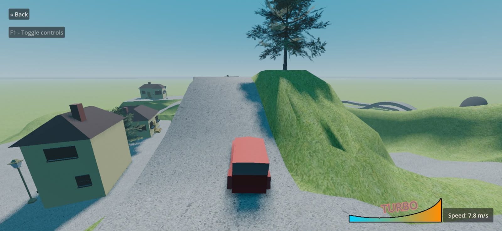
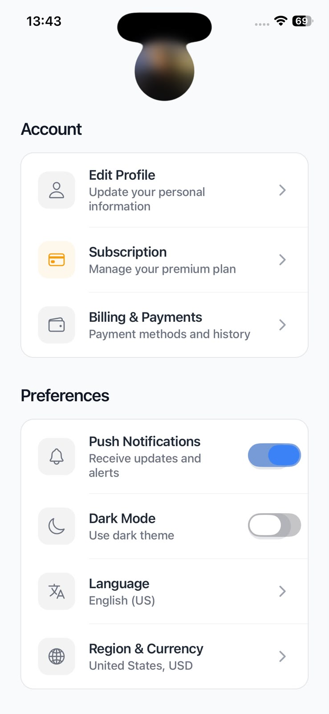
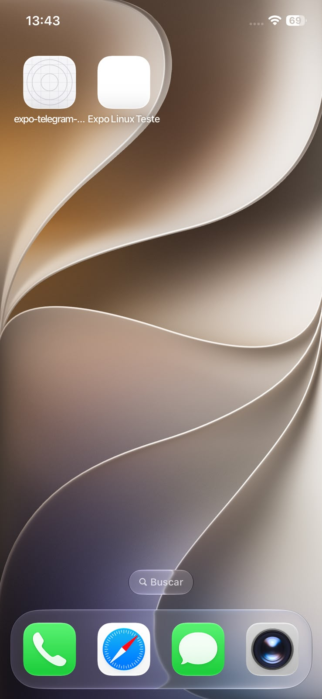

# Reproduced projects

These are specific projects built with ios-anywhere and tested on a real iPhone. Screenshots were supplied by the tester and are published with permission. They record observed results, not universal engine compatibility or automated device tests.

| Project | Engine | Confirmed result | Evidence |
| --- | --- | --- | --- |
| [Truck Town](https://github.com/godotengine/godot-demo-projects/tree/master/3d/truck_town) | Godot / GDScript | Built on another Linux PC, signed, installed, and running on an iPhone. | [Gameplay screenshot](#godot-truck-town) |
| [Expo Meatball Animation](https://github.com/rit3zh/expo-meatball-animation) | Expo SDK 53 / React Native / Skia | Built on another Linux PC, installed, and opened with the initial interface rendered. | [App and installation screenshots](#expo-meatball-animation) |
| [Expo counter sample](../examples/expo-counter) | Expo SDK 54 | Built locally, installed on an iPhone, and counter interaction demonstrated. | [Continuous recording](../README.md#demo) |

## Godot Truck Town

**Confirmed on 2026-10-16.** Guided setup was run on another PC. Build output reported a signed and verified IPA, installation reached `InstallComplete (100%)`, and the tester supplied this screenshot of the running game.

[Upstream project](https://github.com/godotengine/godot-demo-projects/tree/master/3d/truck_town)

The exact upstream commit and host distribution were not recorded. This confirms the demonstrated game on that device, not every Godot renderer, plugin, or platform feature.

## Expo Meatball Animation

**Confirmed on 2026-10-16.** The tester built the Expo SDK 53 project on another Linux PC, installed it, and supplied screenshots of the open app and its Home Screen icon.

[Upstream project](https://github.com/rit3zh/expo-meatball-animation)

  
  

This test exercised the Expo 53 native dependency fixes for glog, fmt, recursive header paths, read-only Pod sources, and static Skia XCFramework linking ([PR #14](https://github.com/rodriguesabner/ios-anywhere/pull/14), [#15](https://github.com/rodriguesabner/ios-anywhere/pull/15), [#16](https://github.com/rodriguesabner/ios-anywhere/pull/16), [#17](https://github.com/rodriguesabner/ios-anywhere/pull/17)). The app's bundle identifier also had to match its provisioning profile.

The exact upstream commit and final IPA hash were not recorded. Full animation behavior, every interaction, performance and App Store compatibility were not independently verified. The installed icon is generic; this test does not establish finished icon packaging.

## Run your own test

Follow the [five-step guide](../README.md#1-install-the-cli) with your own project, Apple credentials, matching bundle identifier and registered iPhone. See [signing](signing.md) and [validation](validation.md) for details and limitations. The upstream links above track moving branches; reproduce a specific version by recording its commit before building.

Only screenshots and documentation are included here. App sources retain their upstream licenses; signing credentials, provisioning profiles, SDKs and IPA binaries are not published.
